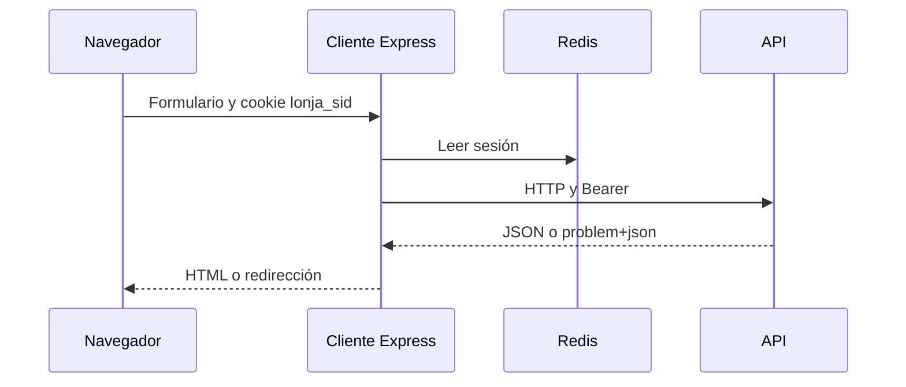

# Arquitectura del cliente

## Responsabilidades

El cliente es un servidor Express con vistas EJS. Traduce formularios y navegación a peticiones REST, conserva la sesión del navegador y adapta los resultados a HTML. El negocio, los permisos definitivos, MariaDB, archivos y correo pertenecen a la API.

`index.js` carga `client/.env`, selecciona el almacenamiento y escucha. `app.js` configura correlación, Helmet/CSP, EJS, cuerpos, cookies, recursos estáticos, sesión, preferencias, comprobación de origen y rutas. Las excepciones terminan en una página controlada; un 401 invalida la sesión y lleva al acceso.

## Módulos

`routes/` organiza cuenta, configuración, usuarios, catálogo, ventas, pedidos y actividad de tienda. Las rutas públicas y el acceso se componen en `app.js`. `views/` agrupa las páginas por función; `public/` aloja JavaScript, estilos e imágenes propios. Bootstrap y Chart.js se sirven localmente desde las dependencias instaladas.

`api.js` restringe destinos al origen y prefijo de `API_URL`, usa fetch nativo con límite de diez segundos, propaga `X-Request-Id` y convierte errores de la API en `ErrorApi`. `validacion.js` reutiliza esquemas de OpenAPI para validar entradas antes de enviarlas; la API vuelve a validar siempre.

Ante un 401, el transporte renueva una vez y repite la petición una vez. Agrupa renovaciones concurrentes de la misma sesión y delega la coordinación entre procesos al almacén Redis. No hace reintentos generales de escrituras: los flujos que lo requieren mantienen su clave de idempotencia.

## Sesiones y archivos

`sesiones.js` administra inicio, expiración, renovación y cierre. `redis-store.js` persiste el estado y coordina rotaciones con bloqueo y confirmación condicional, evitando restaurar una sesión eliminada durante un cierre concurrente. El almacén en memoria solo sirve para desarrollo; reiniciarlo borra sus sesiones.

El navegador no conoce access ni refresh. Recibe un identificador opaco en cookie. Redis contiene tokens del servidor y debe permanecer protegido y persistente. Compartir Redis permite reiniciar o replicar el cliente, mientras la API conserva su restricción de instancia única.

`descargas.js` transmite archivos sin acumular todo el PDF o imagen en memoria. `/uploads` solicita el archivo a la API; el cliente no monta el volumen de uploads ni lo modifica directamente.

Consulta [datos y vistas](02-datos-y-vistas.md), [seguridad](05-seguridad.md) y [la arquitectura conjunta](../../docs/01-arquitectura.md).
