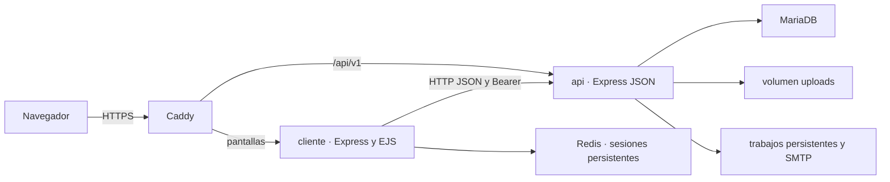

# Arquitectura de Lonja

Lonja v3 separa presentación y negocio en dos proyectos npm independientes, coordinados mediante workspaces.

## Proyectos

`api/app.js` configura rutas REST, errores RFC 9457, correlación, Helmet y límites. `api/index.js` valida la configuración, conecta la base, aplica migraciones, crea semillas, inicia la cola y libera reservas vencidas. Su cierre espera los trabajos en curso. Solo esta aplicación conoce las credenciales de MariaDB y escribe archivos.

`api/modules/` agrupa accounts, catalog, store, orders y sales. Los routers `api/` de cada módulo traducen HTTP a servicios; los modelos, transacciones, reservas, cálculos y propiedad de recursos se resuelven en el servidor. `api/shared/` aporta infraestructura reutilizable y `api/migrations/` registra cambios de esquema.

`client/app.js` sirve EJS y recursos estáticos. Sus rutas llaman a `client/api.js` usando fetch con un tiempo límite. Ese transporte interpreta problem+json, propaga la correlación y coordina una sola renovación por sesión ante solicitudes concurrentes. La validación temprana reutiliza los esquemas de `contracts/openapi.yaml`; la API vuelve a validar siempre.

`contracts/` contiene el contrato OpenAPI compartido. El cliente no importa modelos, servicios ni conexión de la API; ESLint prohíbe esas dependencias. También prohíbe render y redirect dentro de la API.

## Sesiones y consistencia

La API entrega JWT Bearer de 15 minutos y un refresh opaco de ocho horas, almacenado con hash y rotado mediante actualización condicional. Consulta el usuario y la versión de sesión en cada petición. Logout, cambio de contraseña y desactivación revocan el acceso.

El cliente guarda los tokens en una sesión del servidor; el navegador recibe únicamente `lonja_sid` httpOnly, SameSite=Strict y Secure en producción. Las escrituras comprueban Origin. En producción, Redis conserva las sesiones mediante AOF y coordina la rotación del refresh entre procesos. Reiniciar o replicar el cliente no borra sus sesiones. El almacenamiento en memoria queda limitado al desarrollo sin SESSION_REDIS_URL.

Pedidos, pagos y cobros usan claves de idempotencia persistentes. La reserva, la operación y su respuesta se confirman en una transacción. Los lotes y compras usan ETag/If-Match para impedir que una edición sobrescriba otra. Las ventas conservan la unicidad de un cobro por lote.

## Ejecución

Producción usa dos imágenes con usuario sin privilegios, MariaDB y Caddy. Solo Caddy publica 80/443; la base usa una red interna. Los archivos y respaldos viven en volúmenes separados. La API necesita salida a SMTP y comparte la red del proxy sin publicar su puerto. API y cliente disponen de healthcheck y cierre mediante SIGTERM.

Se mantiene una sola API: la cola y los límites se coordinan en el proceso. Los controladores HTML del monolito se retiraron; su referencia está en el [repositorio original](https://github.com/aLIez-ao/sistema-lonja). Todas las pantallas nuevas pasan por el cliente. Véase [despliegue](04-instalacion-y-despliegue.md).

## Dónde continuar

El detalle interno de módulos, servicios, persistencia y trabajos está en [arquitectura de API](../api/docs/01-arquitectura.md). Transporte, EJS, sesiones y adaptación de datos se explican en [arquitectura del cliente](../client/docs/01-arquitectura.md). El [índice](README.md) reúne operación, seguridad y calidad compartidas.
